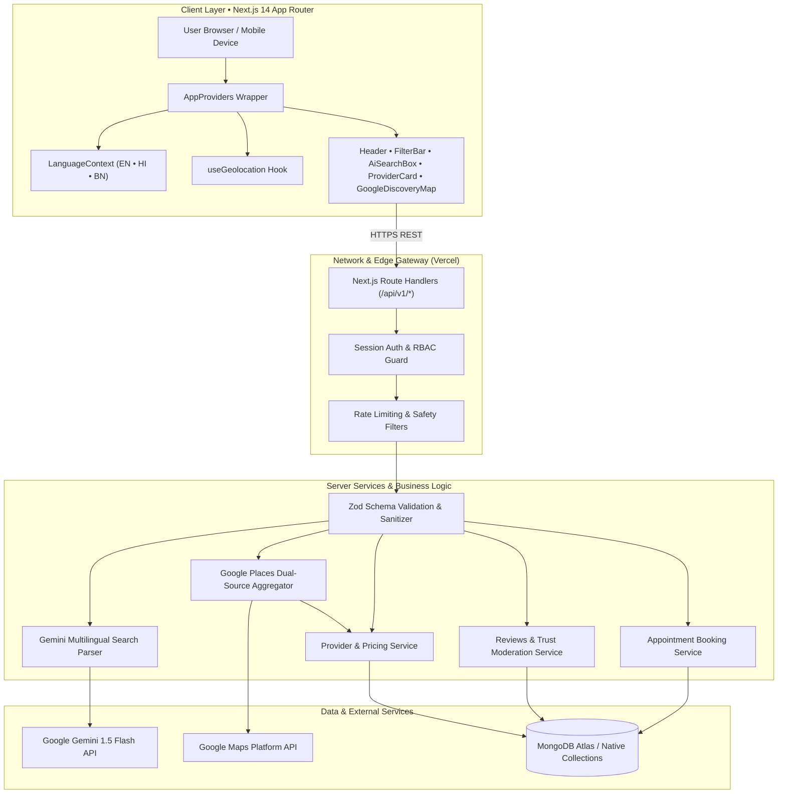
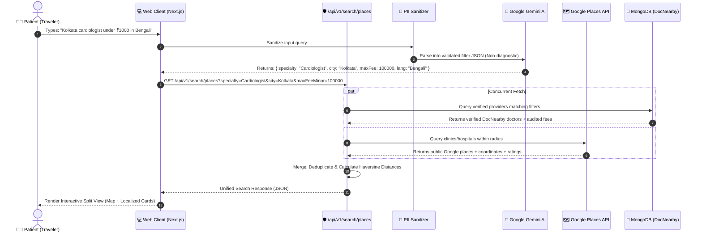

<div align="center">

# 🩺 DocNearby

### *Evidence-Based Healthcare Discovery & Navigation for Travelers*

**Find trusted healthcare, transparent consultation pricing, and verified statutory credentials wherever you are.**

---

[](https://docnearby.vercel.app)
[](https://github.com/Soumyaroy428/DocNearby)
[-000000?style=for-the-badge&logo=next.js&logoColor=white)](https://nextjs.org/)
[-3178C6?style=for-the-badge&logo=typescript&logoColor=white)](https://www.typescriptlang.org/)
[](https://www.mongodb.com/)
[](https://tailwindcss.com/)
[](https://ai.google.dev/)
[](LICENSE)

<br/>

[🌐 **Live Demo**](https://docnearby.vercel.app) • [📖 **System Architecture**](#-system-architecture) • [✨ **Core Features**](#-core-features) • [🧪 **145 Test Suite**](#-test-suite--quality-metrics) • [⚡ **Quickstart**](#-developer-quickstart) • [📡 **API Specs**](#-rest-api-specification)

---

</div>

<br/>

> [!IMPORTANT]
> **Healthcare Safety & Emergency Helpline (India):**  
> DocNearby is an independent discovery and navigation platform. **DocNearby does NOT provide medical diagnosis, emergency triage, clinical prescriptions, or treatment advice.**  
> If you are experiencing a medical emergency, immediately dial local emergency services:  
> 🚨 **Dial 112** (National Emergency Response System) or **102** (Free Ambulance Service).

<br/>

---

## 📑 Table of Contents

- [Problem Statement & Value Proposition](#-problem-statement--value-proposition)
- [Feature Comparison Matrix](#-feature-comparison-matrix)
- [Core Features](#-core-features)
  - [1. Dual-Source Healthcare Discovery](#1-dual-source-healthcare-discovery)
  - [2. Transparent Consultation Fee Schedules](#2-transparent-consultation-fee-schedules)
  - [3. Statutory Regulatory Verification Audits](#3-statutory-regulatory-verification-audits)
  - [4. Native Trilingual Localization (EN • HI • BN)](#4-native-trilingual-localization-en--hi--bn)
  - [5. Privacy-Preserving AI Search Assistant](#5-privacy-preserving-ai-search-assistant)
  - [6. Verified Patient Reviews & Rating Integrity](#6-verified-patient-reviews--rating-integrity)
  - [7. Consultation Appointment Booking](#7-consultation-appointment-booking)
  - [8. Geolocation & Navigation Routing](#8-geolocation--navigation-routing)
- [System Architecture](#-system-architecture)
  - [High-Level Component Architecture](#high-level-component-architecture)
  - [Dual-Source Search & AI Privacy Pipeline](#dual-source-search--ai-privacy-pipeline)
- [Technology Stack](#-technology-stack)
- [Repository Structure](#-repository-structure)
- [Developer Quickstart](#-developer-quickstart)
  - [Prerequisites](#prerequisites)
  - [Step-by-Step Installation](#step-by-step-installation)
  - [Environment Configuration](#environment-configuration)
  - [Running the Development Server](#running-the-development-server)
- [Test Suite & Quality Metrics](#-test-suite--quality-metrics)
- [REST API Specification](#-rest-api-specification)
- [Compliance & Privacy (DPDP Act 2023)](#-compliance--privacy-dpdp-act-2023)
- [Roadmap & Milestones](#-roadmap--milestones)
- [Contributing Guidelines](#-contributing-guidelines)
- [License](#-license)

---

## 💡 Problem Statement & Value Proposition

When domestic or international travelers visit unfamiliar cities across India, accessing dependable healthcare is complicated by four critical barriers:

```
┌─────────────────────────────────────────────────────────────────────────────┐
│                       THE 4 PILLARS OF MEDICAL FRICTION                     │
├──────────────────────┬──────────────────────┬───────────────────────────────┤
│ 💰 OPAQUE PRICING    │ 🛡️ UNVERIFIED CERTS  │ 🗣️ LANGUAGE BARRIERS          │
│ Unpredictable,       │ Difficulty verifying │ Inability to communicate with │
│ inflated, or         │ statutory Medical    │ local practitioners in native │
│ unbenchmarked fees   │ Council credentials  │ Hindi, Bengali, or English    │
├──────────────────────┴──────────────────────┴───────────────────────────────┤
│ 🗺️ FRAGMENTED DATA SOURCES                                                  │
│ Generic map listings lack verified fee schedules, spoken language tags,     │
│ or direct appointment booking capabilities.                                 │
└─────────────────────────────────────────────────────────────────────────────┘
```

**DocNearby bridges this gap** by creating an evidence-based discovery engine combining **Google Places API** public infrastructure with **DocNearby statutory credential audits**, upfront consultation fee records, crowdsourced price verification, and native trilingual assistance.

---

## 📊 Feature Comparison Matrix

| Feature | Generic Search Engines | Traditional Doctor Portals | DocNearby |
|---|:---:|:---:|:---:|
| **Dual-Source Discovery (Google + Registered)** | ❌ Only Google Places | ❌ Only Paid Listed | ✅ **Unified Aggregation** |
| **Consultation Fee Transparency** | ❌ Not Published | ⚠️ Inconsistent / Hidden | ✅ **Recorded in Paise Minor Units** |
| **Price Staleness Warnings (>90d)** | ❌ No | ❌ No | ✅ **Automated Amber Badges** |
| **Crowd Price Discrepancy Reporting** | ❌ No | ❌ No | ✅ **Verified Audit Queue** |
| **Statutory Council Credentials Check** | ❌ No | ⚠️ Self-Reported | ✅ **NMC / WBMC Evidence Audits** |
| **Native Trilingual Toggle (EN • HI • BN)** | ⚠️ Browser Auto-translate | ❌ English Only | ✅ **Native Context Localization** |
| **Privacy-Preserving AI Search (PII-Scrubbed)**| ❌ None | ❌ Rule-based Filters | ✅ **Gemini 1.5 with Non-Diagnostic Guardrails** |
| **GPS Geolocation & Walking Radius** | ✅ Yes | ⚠️ City-level only | ✅ **Haversine Distance (2–50 km)** |
| **Zero Sponsored Doctor Rankings** | ❌ Ad-dominated | ❌ Boosted by Listing Fees | ✅ **Strict Distance & Verification Order** |

---

## ✨ Core Features

### 1. Dual-Source Healthcare Discovery
- **Unified Engine:** Concurrently queries DocNearby's verified database and the Google Places API to deliver comprehensive healthcare listings.
- **Deduplication:** Merges overlapping facilities using geospatial proximity matching and normalized name algorithms.
- **Three Responsive View Modes:**
  - 🎛️ **Split View:** Synchronized interactive map on the right, selectable cards on the left.
  - 🗂️ **Cards View:** Grid layout displaying qualifications, consultation rates, languages, and ratings.
  - 🗺️ **Map View:** Google Map with custom markers, radius circles, and quick facility detail popups.
- **Source Filtering:** Filter by **All Sources**, **DocNearby Verified**, or **Google Places**.

### 2. Transparent Consultation Fee Schedules
- **Zero Floating-Point Error:** All fees are stored and manipulated in minor currency units (paise, $1\text{ INR} = 100\text{ paise}$).
- **Price Staleness Warnings:** Automatically highlights fees older than 90 days with clear warning badges:
  > `⚠️ Unverified 92d ago. Confirm directly with clinic.`
- **Crowdsourced Price Reports:** Patients can submit actual consultation fees paid, complete with receipts and optional anonymity. Confirmed discrepancies trigger administrative price review.

### 3. Statutory Regulatory Verification Audits
- **Registry Grounding:** Practitioner credentials audited against statutory registers (National Medical Commission and State Medical Councils, e.g., West Bengal Medical Council - WBMC).
- **Clear Badge Taxonomy:**
  - 🟢 `Registration verified`: Statutory council registration reference verified on official register.
  - 🟡 `Verification pending`: Submitted credentials awaiting independent audit.
  - ⚪ `Not verified by DocNearby`: Google Places public listing without regulatory credential audit.
- **Semantics Notice:** Clear disclaimer that verification validates existence on official registers, never clinical superiority or guaranteed outcomes.

### 4. Native Trilingual Localization (EN • HI • BN)
- **Instant Client-Side Toggle:** Seamlessly switch between **English**, **हिन्दी (Hindi)**, and **বাংলা (Bengali)** with 0 ms page reload lag.
- **Comprehensive Coverage:** Header, navigation drawer, hero banner, search filters, discovery cards, reviews, provider details, and compliance notices.
- **Persistent Preferences:** Automatically saved in `localStorage('docnearby_lang')` and loaded on all subsequent visits.
- **Medical & Cultural Authenticity:** Terminology tailored for domestic travelers (e.g., *"পরামর্শ ফি"* / *"परामर्श शुल्क"*, *"চেম্বার"* / *"क्लीनिक"*).

### 5. Privacy-Preserving AI Search Assistant
- **Multilingual Freeform Search:** Type in natural language (e.g., *"Find a female dermatologist in Salt Lake under ₹800 who speaks Bengali"*).
- **Automated PII Scrubbing:** All emails, phone numbers, and identity markers are scrubbed before reaching external LLMs.
- **Non-Diagnostic Guardrails:** The assistant exclusively converts symptoms and requests into structured search filters (`specialty`, `locality`, `maxFeeMinor`, `language`), rejecting requests for clinical diagnoses or drug prescriptions.

### 6. Verified Patient Reviews & Rating Integrity
- **1 to 5-Star Ratings:** Weighted aggregation calculating mean score and total review count.
- **Verified Patient Badges:** Distinct badge for users whose appointment attendance was recorded by DocNearby.
- **Provider Right-of-Reply:** Practitioners can submit official public responses to patient feedback.
- **Community Moderation:** Reporting system to flag inappropriate, fraudulent, or defamatory reviews for administrative moderation.

### 7. Consultation Appointment Booking
- **Direct Slot Booking:** Browse practitioner schedules and book morning, afternoon, or evening consultation slots.
- **Conflict Prevention:** Automated backend checks preventing double bookings.
- **Lifecycle Tracking:** Four-stage status progression: `requested` → `confirmed` → `completed` (or `cancelled`).

### 8. Geolocation & Navigation Routing
- **Browser GPS Integration:** One-click *"Near Me"* location lock via `navigator.geolocation` with fallback to city selection.
- **Haversine Distance Sorting:** Computes great-circle distances accurate to within meters.
- **Turn-by-Turn Directions:** Direct deep-link generation for Google Maps navigation with destination coordinates and facility name.

---

## 🏛️ System Architecture

### High-Level Component Architecture



### Dual-Source Search & AI Privacy Pipeline



---

## 🛠️ Technology Stack

| Domain | Technology | Version | Purpose |
|---|---|---|---|
| **Framework** | Next.js | `14.2.35` | App Router, Server Components, Route Handlers |
| **Language** | TypeScript | `5.6.3` | Strict type safety across client, server, and shared layers |
| **Styling** | Tailwind CSS | `3.4.14` | Mobile-first utility design system |
| **Icons** | Lucide React | `0.453.0` | Accessible vector icons |
| **Database** | MongoDB Driver | `7.7.0` | High-throughput native document database driver |
| **Validation** | Zod | `3.23.8` | Schema validation and runtime type inference |
| **AI / NLP** | Google Gemini | `1.5 Flash` | Multilingual query intent parser and phrasebook generator |
| **Mapping** | Google Maps Platform | `v3` | Places API, Maps JS SDK, Turn-by-Turn navigation URLs |
| **Testing** | Vitest | `2.1.9` | High-speed unit and integration testing |
| **DOM Testing** | JSDOM / RTL | `25.0.1` | Headless browser testing environment |
| **Hosting** | Vercel | Production | Serverless Edge SSR and CDN asset distribution |

---

## 📁 Repository Structure

```text
DocNearby/
├── app/                                 # Next.js 14 App Router
│   ├── layout.tsx                       # Root HTML layout with AppProviders wrapper
│   ├── page.tsx                         # Homepage view (Hero, AI Assistant, Results)
│   ├── discovery/                       # Healthcare discovery page (Google Maps + DB)
│   ├── appointments/                    # Patient appointment management page
│   ├── providers/[id]/                  # Doctor/Clinic detailed profile view
│   ├── admin/                           # Administrative management
│   │   ├── verification/                # Provider statutory credential audit panel
│   │   ├── price-reports/               # Crowdsourced fee dispute resolution
│   │   └── reviews/                     # Patient review moderation queue
│   ├── privacy/ & terms/ & contact/     # DPDP Act compliance, terms, grievance redressal
│   └── api/v1/                          # REST API route handlers
├── client/                              # Frontend presentation layer
│   ├── components/
│   │   ├── layout/                      # Header, Footer, Mobile Drawer
│   │   ├── search/                      # AiSearchBox, FilterBar
│   │   ├── discovery/                   # UnifiedResultCard, Split/Card views
│   │   ├── maps/                        # GoogleDiscoveryMap, ProviderMapView, FacilityMap
│   │   ├── providers/                   # ProviderCard, ProviderDetailsView, SaveButton
│   │   ├── multilingual/                # LanguageSelector (EN, HI, BN)
│   │   └── appointments/                # BookAppointmentModal
│   ├── context/
│   │   └── LanguageContext.tsx          # Global i18n translations & state
│   ├── hooks/
│   │   └── useGeolocation.ts            # GPS device location hook with permission states
│   └── views/                           # Page-level view orchestrators
├── server/                              # Backend services & business logic
│   ├── ai/                              # Gemini prompt engineering & search intent parser
│   ├── auth/                            # Password hashing & stateless session auth
│   ├── db/                              # MongoDB connection pool & health check
│   ├── repositories/                    # Database data access objects
│   ├── services/                        # Business logic (Providers, Places, Reviews)
│   └── validation/                      # Zod validation schemas
├── shared/                              # Code shared between client and server
│   ├── types/                           # TypeScript interfaces (Provider, Review, Auth)
│   └── utils/                           # Formatters, Geo calculation, currency converters
└── tests/                               # Vitest automated test suite (145 tests)
```

---

## 💻 Developer Quickstart

### Prerequisites

- **Node.js:** `v18.17.0` or higher (`v20.x` LTS recommended)
- **Package Manager:** `npm` (bundled with Node.js)
- **MongoDB:** Local MongoDB instance OR free [MongoDB Atlas Cluster](https://www.mongodb.com/atlas)
- **Google Maps API Key:** (Optional: Dual-source map operates gracefully in demo mode if unconfigured)
- **Gemini API Key:** (Optional: Multilingual AI operates with fallback keyword parsing if unconfigured)

### Step-by-Step Installation

```bash
# 1. Clone the repository
git clone https://github.com/Soumyaroy428/DocNearby.git
cd DocNearby

# 2. Install dependencies
npm install

# 3. Create your local environment file
cp .env.example .env.local
```

### Environment Configuration

Configure the keys in your `.env.local`:

```ini
# ==============================================================================
# Database Configuration
# ==============================================================================
# MongoDB Atlas or local MongoDB connection string:
MONGODB_URI=mongodb+srv://<username>:<password>@cluster.mongodb.net/docnearby?retryWrites=true&w=majority

# ==============================================================================
# Authentication & Security
# ==============================================================================
NEXTAUTH_URL=http://localhost:3000
NEXTAUTH_SECRET=super_secret_32_character_random_string

# ==============================================================================
# Google Gemini API (Multilingual AI Search & Phrasebook)
# ==============================================================================
GEMINI_API_KEY=AIzaSy...your_gemini_api_key

# ==============================================================================
# Google Maps Platform (Healthcare Places & Interactive Maps)
# ==============================================================================
# Server-side key for Google Places API:
GOOGLE_MAPS_API_KEY=AIzaSy...your_server_key

# Browser client key for interactive maps rendering:
NEXT_GOOGLE_MAPS_API_KEY=AIzaSy...your_client_key

# ==============================================================================
# Application Environment
# ==============================================================================
NODE_ENV=development
```

### Running the Development Server

```bash
# Start local development server with Turbopack / Next.js
npm run dev
```

Visit [http://localhost:3000](http://localhost:3000) in your browser.

---

## 🧪 Test Suite & Quality Metrics

DocNearby enforces rigorous software quality with **145 automated unit and integration tests** executed via Vitest and JSDOM:

```bash
# Run all 145 tests in batch mode
npm test

# Run tests in interactive watch mode
npm run test:watch

# Execute strict TypeScript type verification (zero error tolerance)
npm run typecheck

# Execute full Next.js production compilation
npm run build
```

### Test Suite Coverage Breakdown

```text
 ✓ tests/ai-multilingual-assistance.test.ts (18 tests)  - Privacy scrub, multilingual intent, Hindi/Bengali fallbacks
 ✓ tests/object-level-auth.test.ts          (6 tests)   - RBAC rules, patient/provider/admin route guards
 ✓ tests/geospatial-search.test.ts          (13 tests)  - Haversine algorithm, radius bounding, distance sorting
 ✓ tests/provider-verification.test.ts      (8 tests)   - NMC/WBMC registry audits, status state machine
 ✓ tests/provider-service.test.ts           (11 tests)  - Provider CRUD, facility links, specialty search
 ✓ tests/reviews-and-trust.test.ts          (16 tests)  - 1-5 star ratings, verified badges, moderation queue
 ✓ tests/production-readiness-smoke.test.ts (4 tests)   - Critical SSR paths, route stability, seed data integrity
 ✓ tests/transparent-pricing.test.ts        (21 tests)  - Minor currency (paise) math, 90d staleness, crowd reports
 ✓ tests/google-places-integration.test.ts  (17 tests)  - Dual-source deduplication, fallback gracefully
 ✓ tests/appointment-service.test.ts       (14 tests)  - Slot conflicts, booking lifecycles, provider queues
 ✓ tests/auth-service.test.ts               (9 tests)   - Password hashing (bcrypt), token validation
 ✓ tests/ai-search-service.test.ts          (4 tests)   - Non-diagnostic guardrail verification
 ✓ tests/utils.test.ts                      (4 tests)   - Currency formatters, date localization, sanitizers

Test Files:  13 passed (13)
Total Tests: 145 passed (145)
Duration:    ~5.18s
```

---

## 📡 REST API Specification

All endpoints are versioned under `/api/v1/*` and adhere to uniform response structures:
```typescript
interface ApiResponse<T> {
  data?: T;
  error?: { code: string; message: string; details?: unknown };
  meta?: Record<string, unknown>;
}
```

### Core Endpoints

| Method | Endpoint | Description | Auth Required |
|---|---|---|:---:|
| `GET` | `/api/v1/health` | Service and MongoDB cluster health check | No |
| `GET` | `/api/v1/metadata` | Distinct search options (cities, specialties, languages) | No |
| `GET` | `/api/v1/providers` | Query doctors with distance, fee, language, and specialty filters | No |
| `GET` | `/api/v1/providers/:id` | Full provider profile with audited credentials and facilities | No |
| `POST`| `/api/v1/providers/apply` | Practitioner onboarding and credential verification submission | No |
| `GET` | `/api/v1/search/places` | Dual-source search combining Google Places and DocNearby registry | No |
| `POST`| `/api/v1/ai/search-intent`| Parse multilingual natural language query into validated filters | No |
| `POST`| `/api/v1/ai/phrasebook` | Generate traveler medical phrases for symptoms and questions | No |
| `GET` | `/api/v1/providers/:id/reviews` | List patient ratings, verified badges, and provider responses | No |
| `POST`| `/api/v1/providers/:id/reviews` | Submit patient rating and comment (1–5 stars) | Yes |
| `POST`| `/api/v1/providers/:id/reviews/:reviewId/flag` | Report a review for administrative moderation | Yes |
| `POST`| `/api/v1/providers/:id/price-report` | Submit crowdsourced fee discrepancy report with receipt | Yes |
| `GET` | `/api/v1/appointments` | List user appointment bookings | Yes |
| `POST`| `/api/v1/appointments` | Request appointment slot reservation | Yes |
| `PATCH`| `/api/v1/appointments/:id/status` | Update booking status (`confirmed`, `cancelled`, etc.) | Yes |

---

## ⚖️ Compliance & Privacy (DPDP Act 2023)

DocNearby is architected in accordance with India's **Digital Personal Data Protection (DPDP) Act 2023**:

1. **Purpose Limitation:** User data (location, queries, appointments) is collected strictly to facilitate healthcare discovery.
2. **AI Privacy Sanitization:** Freeform AI prompts are scrubbed of phone numbers, email addresses, and names before any third-party model inference.
3. **No Clinical Diagnosis Storage:** DocNearby explicitly forbids the storage of electronic health records (EHR) or diagnostic test reports, avoiding unintended exposure of sensitive medical data.
4. **Data Principal Rights:** Users can inspect, export, or permanently delete their account data and saved providers at any time.

---

## 🗺️ Roadmap & Milestones

- [x] **Milestone 1:** Foundation, MongoDB Native Driver, Zod Validation, and Core Models.
- [x] **Milestone 2:** Dual-Source Google Places & DocNearby Healthcare Discovery Engine.
- [x] **Milestone 3:** Transparent Pricing with 90-day Staleness & Crowd Discrepancy Reporting.
- [x] **Milestone 4:** Statutory Medical Council (NMC / WBMC) Credential Auditing System.
- [x] **Milestone 5:** Appointment Booking Workflow & Conflict Management.
- [x] **Milestone 6:** Verified Patient Reviews, Ratings Integrity & Provider Responses.
- [x] **Milestone 7:** AI-Assisted Multilingual Search (English, Hindi, Bengali) with Privacy Scrubbers.
- [x] **Milestone 8:** Full-Stack Live Production Deployment on Vercel (`https://docnearby.vercel.app`).
- [ ] **Milestone 9:** Teleconsultation link integration for verified remote travel doctors.
- [ ] **Milestone 10:** Expansion of pilot cities to New Delhi, Mumbai, Bengaluru, and Chennai.

---

## 🤝 Contributing Guidelines

Contributions are welcome! Please follow these steps:

1. **Fork the Repository:** Create your own branch (`git checkout -b feature/amazing-feature`).
2. **Follow Code Standards:**
   - Maintain 100% strict TypeScript typing (no `any` without justification).
   - Ensure consultation fee amounts are always handled in minor units (paise).
   - Ensure non-diagnostic healthcare disclaimers are preserved across UI views.
3. **Run Quality Checks:**
   ```bash
   npm run typecheck
   npm test
   ```
4. **Commit Your Changes:** Follow Conventional Commits (`git commit -m 'feat: add regional language support for Tamil'`).
5. **Open a Pull Request:** Submit to the `main` branch with detailed release notes.

---

## 📜 License

This project is licensed under the **MIT License** — see the [LICENSE](LICENSE) file for details.

```
Copyright (c) 2026 DocNearby Contributors

Permission is hereby granted, free of charge, to any person obtaining a copy
of this software and associated documentation files (the "Software"), to deal
in the Software without restriction, including without limitation the rights
to use, copy, modify, merge, publish, distribute, sublicense, and/or sell
copies of the Software, and to permit persons to whom the Software is
furnished to do so, subject to the following conditions:

The above copyright notice and this permission notice shall be included in all
copies or substantial portions of the Software.
```

<div align="center">
  <sub>Built with ❤️ to ensure travelers never have to navigate unfamiliar healthcare alone.</sub>
</div>
