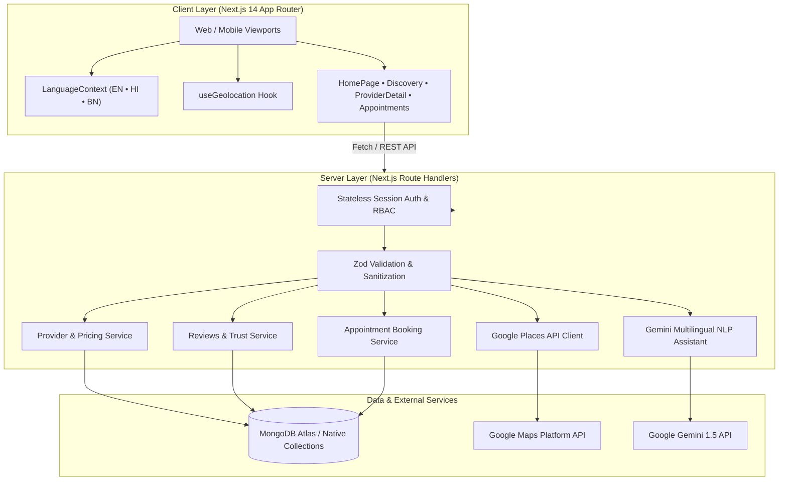

# 🩺 DocNearby

> **Evidence-Based Healthcare Discovery & Navigation for Travelers**  
> Transparent consultation fees, regulatory credential verifications, dual-source Google Maps discovery, and native multilingual assistance across English, Hindi, and Bengali.

[](https://docnearby.vercel.app)
[](https://github.com/Soumyaroy428/DocNearby)
[](https://nextjs.org/)
[](https://www.typescriptlang.org/)
[](https://www.mongodb.com/)
[](https://tailwindcss.com/)

---

## 📖 Table of Contents

- [Vision & Problem Statement](#-vision--problem-statement)
- [Key Features](#-key-features)
- [System Architecture](#-system-architecture)
- [Technology Stack](#-technology-stack)
- [Repository Structure](#-repository-structure)
- [Getting Started](#-getting-started)
  - [Prerequisites](#prerequisites)
  - [Installation](#installation)
  - [Environment Variables](#environment-variables)
  - [Running the App](#running-the-app)
- [Test Suite & Quality Verification](#-test-suite--quality-verification)
- [REST API Reference](#-rest-api-reference)
- [Healthcare Safety & Compliance Notice](#-healthcare-safety--compliance-notice)
- [License](#-license)

---

## 🎯 Vision & Problem Statement

When traveling or relocating to unfamiliar cities across India, accessing medical care presents critical challenges:
1. **Opaque & Inconsistent Pricing:** Travelers frequently face unstandardized, undisclosed fees with no prior price benchmarks.
2. **Unverified Credentials:** Distinguishing legally registered doctors with State Medical Council credentials from unverified clinics is difficult.
3. **Language Barriers:** Inability to communicate effectively in Hindi, Bengali, or English during medical consultations.
4. **Scattered Information:** Public Google Maps listings often lack regulatory credential audits, verified consultation fees, or direct booking options.

**DocNearby** resolves these friction points by combining **Google Places healthcare facility discovery** with **DocNearby-verified practitioner profiles**, transparent fee schedules, patient crowd verification, and localized multilingual interfaces.

---

## 🌟 Key Features

### 1. 🗺️ Dual-Source Healthcare Discovery
- Merges publicly registered Google Places facilities (clinics, hospitals, diagnostic labs) with DocNearby-verified practitioners.
- Interactive view modes:
  - **Split View:** Responsive side-by-side synchronized map and listing cards.
  - **Cards View:** Clean grid layout optimized for mobile and desktop reading.
  - **Map View:** Fullscreen interactive Google Maps with custom markers and clustering.
- Source filter pills: Quickly toggle between **All Sources**, **DocNearby Verified**, and **Google Places**.

### 2. 💰 Transparent Consultation Pricing
- Upfront consultation fees displayed in INR (stored in minor currency units/paise for zero floating-point errors).
- **Price Staleness Warnings:** Automatically flags rates confirmed `>90 days ago` with amber badges.
- **Price Discrepancy Reporting:** Patients can submit real fee receipts to contest outdated prices, routed directly to an admin dispute resolution queue.

### 3. 🛡️ Statutory Regulatory Credential Verification
- Verifies identity and registration references against official registers (National Medical Commission & State Medical Councils, e.g., WBMC).
- Transparent audit trails indicating verification status (`verified`, `pending`, `not_verified_by_docnearby`).
- Prominent disclaimers confirming that credential verification validates official registry existence rather than clinical superiority.

### 4. 🌐 Native Multilingual Interface (EN • HI • BN)
- Global instant language toggle between **English**, **हिन्दी (Hindi)**, and **বাংলা (Bengali)**.
- Localized across every component: Header, Hero, AI Search, Filters, Provider Cards, Map Views, Profile Pages, and Safety Footers.
- Language preference saved to `localStorage('docnearby_lang')` for seamless cross-session persistence.

### 5. 🤖 AI-Powered Multilingual Healthcare Assistant
- Accepts natural language inputs in English, Hindi, or Bengali (e.g., *"কলকাতায় শিশুর ডাক্তার ইংরেজি বলেন এবং ভিজিট ₹১,০০০ এর নিচে"*).
- **Strict Privacy Sanitization:** Scrubs phone numbers, email addresses, and personally identifiable health data prior to processing.
- **Non-Diagnostic Guardrails:** Translates queries exclusively into structured search filters (specialty, locality, maximum fee, spoken language) without generating medical diagnoses.

### 6. ⭐ Verified Patient Reviews & Trust Moderation
- 1 to 5-star ratings with optional verified consultation badges.
- Provider response mechanism allowing doctors to publicly respond to feedback.
- Automated moderation pipeline and community flagging system to prevent defamation or fake reviews.

### 7. 📅 Direct Appointment Booking
- Book consultation slots directly with verified DocNearby providers.
- Real-time slot conflict checks and status lifecycle tracking (`requested` → `confirmed` → `completed` / `cancelled`).

### 8. 📍 Device Geolocation & Proximity Search
- Precise distance calculation via the **Haversine formula**.
- GPS device integration (`useGeolocation` hook) with 2 km (walking), 5 km, 10 km, 25 km, and 50 km search radii.
- One-click **Google Maps Turn-by-Turn Directions** URL generator.

---

## 🏗️ System Architecture



---

## 💻 Technology Stack

| Layer | Technologies |
|---|---|
| **Framework** | Next.js 14 (App Router, Server Components, Route Handlers) |
| **Language** | TypeScript 5.6 (Strict Type Checking) |
| **Styling & UI** | Tailwind CSS 3.4, Lucide Icons, Responsive Mobile Drawer |
| **Database** | MongoDB (Native MongoDB Driver v7.x with resilient mock fallbacks) |
| **AI Integration** | Google Gemini 1.5 API (Structured search intent & Medical phrasebook) |
| **Mapping & Geo** | Google Maps JavaScript API, Google Places API, Haversine Geospatial Algorithm |
| **Testing** | Vitest 2.1, JSDOM, React Testing Library |
| **Deployment** | Vercel (Edge-optimized serverless SSR & static asset delivery) |

---

## 📂 Repository Structure

```text
DocNearby/
├── app/                                 # Next.js 14 App Router root
│   ├── layout.tsx                       # Root HTML layout with AppProviders wrapper
│   ├── page.tsx                         # Landing / Search home page
│   ├── discovery/                       # Unified Google Places & DocNearby map view
│   ├── appointments/                    # Patient appointment management
│   ├── providers/[id]/                  # Verified doctor / clinic profile details
│   ├── admin/                           # Verifications, reviews & price report moderation
│   ├── privacy/ & terms/ & contact/     # Legal, DPDP compliance & grievance redressal
│   └── api/v1/                          # REST API route handlers
├── client/                              # Client-side presentation layer
│   ├── components/
│   │   ├── layout/                      # Header, Footer, Mobile Drawer
│   │   ├── search/                      # AiSearchBox, FilterBar
│   │   ├── discovery/                   # UnifiedResultCard, Split views
│   │   ├── maps/                        # GoogleDiscoveryMap, ProviderMapView, FacilityMap
│   │   ├── providers/                   # ProviderCard, ProviderDetailsView, SaveButton
│   │   ├── multilingual/                # LanguageSelector (EN, HI, BN)
│   │   └── appointments/                # BookAppointmentModal
│   ├── context/
│   │   └── LanguageContext.tsx          # Global i18n translations & state
│   ├── hooks/
│   │   └── useGeolocation.ts            # Browser GPS device location hook
│   └── views/                           # High-level page view orchestrators
├── server/                              # Server-side business logic
│   ├── ai/                              # Gemini prompt engineering & search intent parser
│   ├── auth/                            # Password hashing & session token management
│   ├── db/                              # MongoDB client connection & health check
│   ├── repositories/                    # Database data access objects
│   ├── services/                        # Core business services (providers, reviews, places)
│   └── validation/                      # Zod validation schemas
├── shared/                              # Code shared between client and server
│   ├── types/                           # TypeScript interfaces (provider, review, discovery, etc.)
│   └── utils/                           # Formatters, Geo calculation, currency converters
└── tests/                               # Vitest automated test suite (145 tests)
```

---

## 🚀 Getting Started

### Prerequisites

- **Node.js:** v18.17.0 or higher (v20+ recommended)
- **Package Manager:** `npm` (included with Node.js)
- **MongoDB:** A local MongoDB instance or [MongoDB Atlas](https://www.mongodb.com/atlas) connection string (optional; falling back to in-memory seed data if unconfigured).
- **Google Maps API Key:** (Optional; demo mode operates gracefully if omitted).

### Installation

1. **Clone the repository:**
   ```bash
   git clone https://github.com/Soumyaroy428/DocNearby.git
   cd DocNearby
   ```

2. **Install project dependencies:**
   ```bash
   npm install
   ```

### Environment Variables

Create a `.env.local` file in the root directory by copying `.env.example`:

```bash
cp .env.example .env.local
```

Configure the following variables:

```ini
# Database (MongoDB connection string)
MONGODB_URI=mongodb+srv://<username>:<password>@<cluster>.mongodb.net/docnearby?retryWrites=true&w=majority

# Application & Auth Secret
NEXTAUTH_URL=http://localhost:3000
NEXTAUTH_SECRET=your_super_secret_32_character_random_string

# Google Gemini API Key (For natural language search & medical phrasebook)
GEMINI_API_KEY=your_gemini_api_key_here

# Google Maps Platform (For places discovery & interactive maps)
GOOGLE_MAPS_API_KEY=your_server_google_maps_api_key_here
NEXT_PUBLIC_GOOGLE_MAPS_API_KEY=your_client_google_maps_key_here

# App Environment
NODE_ENV=development
```

### Running the App

Start the local development server:

```bash
npm run dev
```

Open [http://localhost:3000](http://localhost:3000) in your web browser.

---

## 🧪 Test Suite & Quality Verification

DocNearby maintains a comprehensive unit and integration test suite covering data validation, authorization, pricing calculations, geospatial filtering, and security:

```bash
# Run all unit and integration tests (Vitest)
npm test

# Run tests in interactive watch mode
npm run test:watch

# Execute strict TypeScript typecheck
npm run typecheck

# Build and verify production compilation
npm run build
```

### Test Coverage Highlights (145 Tests Passing):
- `tests/ai-multilingual-assistance.test.ts`: Privacy scrubbing, multilingual intent extraction, and language fallbacks.
- `tests/geospatial-search.test.ts`: Haversine formula bounds, distance sorting, and radius containment.
- `tests/transparent-pricing.test.ts`: Paise minor unit arithmetic, 90-day staleness threshold, and crowd reports.
- `tests/provider-verification.test.ts`: Council credentials audit, registration numbers, and status transitions.
- `tests/google-places-integration.test.ts`: Dual-source result deduplication, rating mappings, and degradation handling.
- `tests/reviews-and-trust.test.ts`: Rating constraints (1-5), verified user badges, provider responses, and moderation flags.
- `tests/appointment-service.test.ts`: Slot bookings, availability checks, and status state machine.
- `tests/object-level-auth.test.ts`: Role-based access control (Patient, Provider, Admin) and password security.

---

## 📡 REST API Reference

All REST endpoints reside under `/api/v1/*` and return consistent JSON payloads `{ data, error, meta }`:

| Method | Endpoint | Description | Auth Required |
|---|---|---|---|
| `GET` | `/api/v1/health` | Service and MongoDB database health check | No |
| `GET` | `/api/v1/metadata` | Distinct search options (cities, specialties, languages) | No |
| `GET` | `/api/v1/providers` | Query providers with geospatial, specialty, fee, and language filters | No |
| `GET` | `/api/v1/providers/:id` | Detailed provider profile with facilities and verified prices | No |
| `POST` | `/api/v1/providers/apply` | Doctor / Clinic listing application submission | No |
| `GET` | `/api/v1/search/places` | Dual-source search combining Google Places and DocNearby listings | No |
| `POST` | `/api/v1/ai/search-intent` | Multilingual natural language query parser into filter JSON | No |
| `POST` | `/api/v1/ai/phrasebook` | Medical translation phrasebook for common symptoms | No |
| `GET` | `/api/v1/providers/:id/reviews` | List verified patient ratings and public provider responses | No |
| `POST` | `/api/v1/providers/:id/reviews` | Submit a patient review (1-5 stars with comments) | Yes |
| `POST` | `/api/v1/providers/:id/price-report`| Submit crowd dispute against outdated consultation fees | Yes |
| `GET` | `/api/v1/appointments` | List patient / provider appointment bookings | Yes |
| `POST` | `/api/v1/appointments` | Request appointment slot reservation | Yes |
| `PATCH`| `/api/v1/appointments/:id/status` | Confirm, reschedule, or cancel appointment | Yes |

---

## ⚠️ Healthcare Safety & Compliance Notice

> ### 🚨 Medical Emergency Notice (India)
> **DocNearby is an independent discovery and navigation directory. It does NOT provide medical diagnosis, emergency triage, treatment advice, or prescriptions.**  
> If you are experiencing a medical emergency, immediately call local emergency services:  
> 📞 **112** (National Emergency) or **102** (Ambulance Service).

- **Evidence-Based Semantics:** Regulatory verification indicates that credentials were authenticated against statutory government registers (e.g., NMC / State Councils). It does not certify clinical superiority, diagnostic accuracy, or guaranteed treatment outcomes.
- **Pricing Estimates:** Consultation fees reflect recorded baseline rates and do not guarantee the total cost of extended procedures, medications, or diagnostic tests.
- **Data Privacy:** Fully compliant with India's **Digital Personal Data Protection (DPDP) Act 2023**. AI search inputs are scrubbed of phone numbers, emails, and identifiers before processing.

---

## 📄 License

This project is licensed under the [MIT License](LICENSE).  
Developed with ❤️ to empower travelers with transparent, accessible, and verified healthcare wherever they go.
